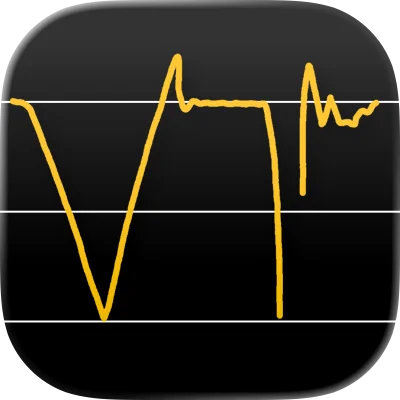
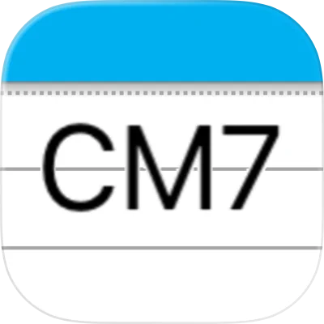
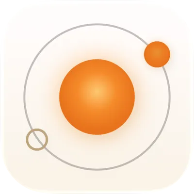
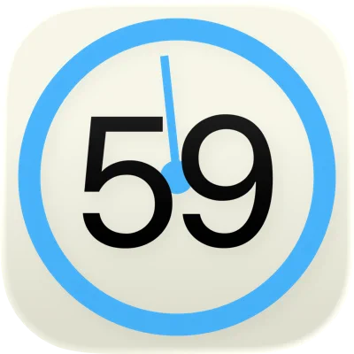

[English](./index.md) | [日本語](./ja.md) | [한국어](./ko.md) | [简体中文](./zh-Hans.md) | [繁體中文](./zh-Hant.md) | **Deutsch** | [Español](./es.md) | [Français](./fr.md) | [Italiano](./it.md) | [Nederlands](./nl.md) | [Português (BR)](./pt-BR.md) | [Русский](./ru.md) | [Türkçe](./tr.md)

# Harmolo

Harmolo entwickelt Apps, die deiner Musik und deinem Alltag ein wenig mehr geben.

## Apps

###  VocalTuner

Ein Stimmgerät, das die Tonhöhe deines Gesangs als Verlaufsspur in Echtzeit zeichnet.

- [iOS: App Store](https://apps.apple.com/us/app/vocaltuner-pitch-training/id1505735245)
- [Android: Google Play](https://play.google.com/store/apps/details?id=com.harmolo.vocaltuner)
- [Web](https://vocal-tuner-36497.web.app/)

###  folino

Ein Notenbetrachter und -player, der auch deine Notensammlung organisiert.

- [iOS: App Store](https://apps.apple.com/us/app/folino-score-viewer-player/id6766994527)
- [Android: Google Play](https://play.google.com/store/apps/details?id=com.harmolo.folino)

###  Chord Memo

Eine einfache Notiz-App zum Festhalten und Ordnen von Akkordfolgen.

- [iOS: App Store](https://apps.apple.com/us/app/chord-memo/id6446309728)

###  Synced Metronome

Ein Metronom, das auf mehreren Geräten synchron läuft.

- [iOS: App Store](https://apps.apple.com/us/app/synced-metronome/id6791674072)

###  SeClock

Ein Uhr-Widget, das die Sekunden anzeigt.

- [iOS: App Store](https://apps.apple.com/us/app/seclock-seconds-clock-widget/id6445807658)

## Kontakt

E-Mail: [jiyi.meta@gmail.com](mailto:jiyi.meta@gmail.com)

## Datenschutzerklärung

- [Datenschutzerklärung](./privacy-policy/de.md)
